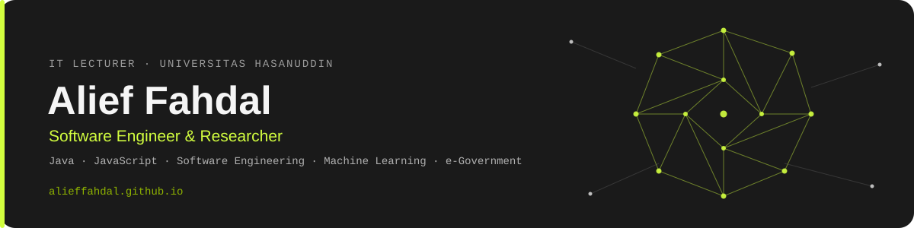

IT developer and lecturer in Informatics Engineering at Universitas Hasanuddin, focused on Java &amp; JavaScript for backend systems and web solutions. Member of the Distributed Intelligence Research Group (DINT), working across software engineering, machine learning, and digital government transformation.

### Top Skills
    

### Tech Stack
          

### Portfolio &amp; Research
**[alieffahdal.github.io](https://alieffahdal.github.io)** &middot; **[Google Scholar](https://scholar.google.com/citations?user=-XzpS1MAAAAJ&hl=en)** &middot; **[SINTA](https://sinta.kemdiktisaintek.go.id/authors/profile/6791876)** &middot; **[ORCID](https://orcid.org/0000-0002-1381-4009)** &middot; **[ResearchGate](https://www.researchgate.net/profile/Muhammad-Alief-Imran-Oemar)**

---

- 🏫 Currently working as **Assistant Professor of Informatics Engineering @ Universitas Hasanuddin**
- 🏛️ Serving as **e-Government (SPBE) Assessor @ Kementerian PANRB**
- 🧠 Exploring **machine learning applications**, including LSTM-based earthquake forecasting
- 📄 36+ indexed publications, h-index 7 on Google Scholar
- 👯 Looking to collaborate on **software engineering &amp; e-Government research**
- 💬 Ask me about **Java/JavaScript backend development, software engineering, or SPBE/digital government transformation**
- 📫 Reach me: [Email](mailto:alieffahdal@unhas.ac.id) &middot; [LinkedIn](https://id.linkedin.com/in/alieffahdal) &middot; [Google Scholar](https://scholar.google.com/citations?user=-XzpS1MAAAAJ&hl=en)

# 📊 GitHub Stats

